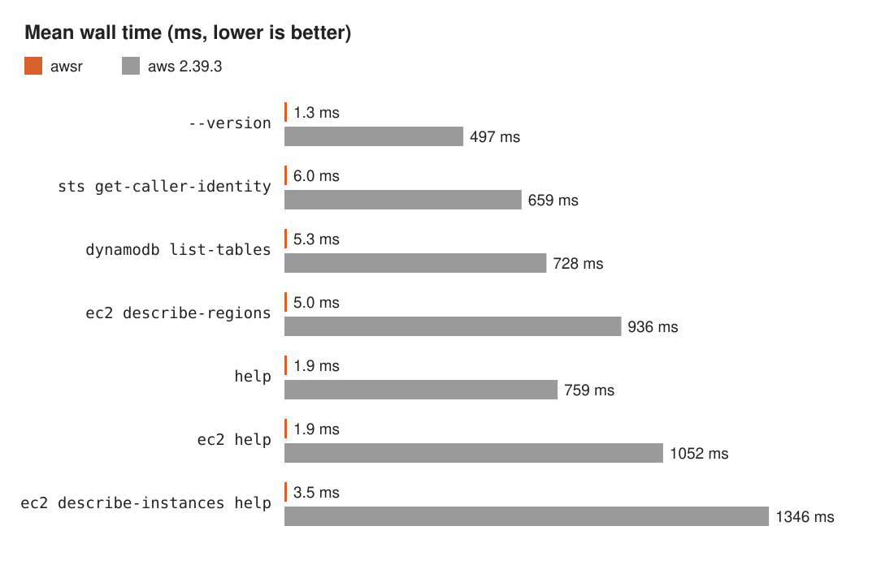

<p align="center">
  
</p>

<p align="center">
  <b>A fast, output-compatible Rust reimplementation of the AWS CLI v2</b>
</p>

<p align="center">
  <a href="https://github.com/conao3/rust-awscli/releases/latest"></a>
  <a href="https://github.com/conao3/rust-awscli/actions/workflows/ci.yml"></a>
  <a href="LICENSE"></a>
  <a href="Cargo.toml"></a>
  <a href="https://github.com/conao3/rust-awscli/stargazers"></a>
</p>

<p align="center">
  <a href="#install">Install</a> ·
  <a href="#usage">Usage</a> ·
  <a href="#performance">Performance</a> ·
  <a href="#development">Development</a> ·
  <a href="https://github.com/conao3/rust-awscli/releases">Releases</a>
</p>

---

`awsr` takes the command line of the [AWS CLI v2](https://github.com/aws/aws-cli) and prints byte-for-byte identical output. `awsr sts get-caller-identity` finishes in 6.0 ms; `aws` takes 659 ms on the same machine, 110 times as long.

- **Same output.** Your scripts, `--query` expressions, and `--output` formats give the same bytes they give with `aws`. [Differential testing](#differential-testing) runs both CLIs on the operations of all services and compares what they print.
- **Its own name.** What `awsr` says about itself names `awsr`: `--version` prints `awsr/<version> (aws-cli/<reference version> compatible) <system>/<release> <machine>`, and the usage lines, the `awsr: [ERROR]:` prefix of error messages, and the command lines of the help pages name `awsr`. The text of messages and help pages is the reference's.
- **All services.** `awsr` embeds the botocore service models of a pinned AWS CLI release (`models/VERSION`) and interprets them at run time. You can call any service and operation of that release as `awsr <service> <operation>`.

`awsr` is not an official AWS product.

## Install

### Prebuilt binaries

The [GitHub releases](https://github.com/conao3/rust-awscli/releases) carry binaries for Linux (x86_64, x86_64 musl, aarch64) and macOS (x86_64, aarch64). Each archive holds one `awsr` executable.

```console
$ curl -L https://github.com/conao3/rust-awscli/releases/latest/download/awsr-<target>.tar.gz | tar xz
```

`<target>` is one of `x86_64-unknown-linux-gnu`, `x86_64-unknown-linux-musl`, `aarch64-unknown-linux-gnu`, `x86_64-apple-darwin`, and `aarch64-apple-darwin`.

### Nix

```console
$ nix profile install github:conao3/rust-awscli
```

### Cargo

```console
$ cargo install awsr
```

The crate takes the vendored models from three data crates (`awsr-models`, `awsr-models-services-a-l`, and `awsr-models-services-m-z`, versioned as the reference release). `cargo install` formats no help page at build time, so `awsr` formats each page with the installed groff on first use.

## Usage

Replace `aws` with `awsr`:

```console
$ awsr sts get-caller-identity
$ awsr dynamodb list-tables --output table
$ awsr ec2 describe-instances --query 'Reservations[].Instances[].InstanceId' --output text
```

`awsr` reads the same `~/.aws/config`, `~/.aws/credentials`, SSO token cache, and environment variables as the AWS CLI.

### Shell completion

bash (`~/.bashrc`):

```bash
if command -v aws_completer > /dev/null; then
    complete -C aws_completer awsr
fi
```

zsh (`~/.zshrc`):

```zsh
autoload -Uz bashcompinit && bashcompinit
if command -v aws_completer > /dev/null; then
    complete -C aws_completer awsr
fi
```

fish (`~/.config/fish/completions/awsr.fish`, or `~/.config/fish/config.fish`):

```fish
if type -q aws_completer
    function __awsr_completer
        set -lx COMP_LINE (commandline -pc)
        set -lx COMP_POINT (string length $COMP_LINE)
        aws_completer | tr -d ' '
    end

    complete -c awsr -f -a "(__awsr_completer)"
end
```

## Performance

<p align="center">
  
</p>

| Command | awsr | aws 2.39.3 | Speedup |
|---|---:|---:|---:|
| `--version` | 1.3 ms | 497 ms | 380× |
| `sts get-caller-identity` | 6.0 ms | 659 ms | 110× |
| `dynamodb list-tables` | 5.3 ms | 728 ms | 140× |
| `ec2 describe-regions` | 5.0 ms | 936 ms | 190× |
| `help` | 1.9 ms | 759 ms | 400× |
| `ec2 help` | 1.9 ms | 1052 ms | 550× |
| `ec2 describe-instances help` | 3.5 ms | 1346 ms | 380× |

The table shows the mean wall time of the flake package (statically linked). `hyperfine -N` ran each command against a local stub endpoint (`--endpoint-url http://127.0.0.1:<port>`) with static credentials on an Intel Core Ultra 5 225U. The reference is the official AWS CLI 2.39.3 Linux installer. The speedup is the aws time divided by the awsr time. The help pages come from the ones formatted at build time; the first help on a machine also runs `groff -v` once and takes 3.8 ms for `ec2 help`. A C hello world takes 1.1 ms on the same machine.

`awsr` embeds the service models and the help inputs uncompressed, in a form it reads in place. A command touches only the parts it uses and parses no JSON at start. With the formatted help pages (36 MB compressed), the binary of the flake package weighs 150 MiB.

The release binaries and the flake package carry every help page formatted by groff at build time (`make help-pages`): groff 1.23.0 of Ubuntu for the release binaries and the groff of nixpkgs for the flake package. `awsr` prints these pages when the groff on `PATH` reports the same version and no `GROFF*` variable is set. Otherwise it formats the page with the installed groff (or mandoc), as the reference does, and keeps the output in `$XDG_CACHE_HOME/awsr/help` (or `~/.cache/awsr/help`), keyed by the page, the awsr and groff binaries, and the groff and locale environment variables.

## Development

```console
$ nix develop
$ make check
```

### Differential testing

`awsr-difftest` (`difftest/`) runs `awsr` and the reference CLI on the same command line against a stub endpoint. The stub answers with responses generated from the operation's output shape. `awsr-difftest` then compares stdout, stderr, the exit code, the streaming output file, and the recorded requests.

```console
$ make difftest        # the cases in difftest/smoke.txt
$ make difftest-full   # every operation of every service, 4 seeds, json / text / table
```

`awsr-difftest` stores reference runs in `target/difftest/refcache`, keyed by the reference build and the prepared case, and replays them on later runs. For a run missing from the cache, it forks one reference process that has loaded the CLI.

- `--refresh-ref-cache` replaces the stored runs.
- `--no-ref-cache` runs the reference for each case.
- `--no-refserver` starts a new reference process for each run.

`difftest/exclusions.txt` lists the operations you cannot compare against a stub, with the reason for each.

## License

Apache-2.0. The embedded models come from [aws/aws-cli](https://github.com/aws/aws-cli) (Apache-2.0).
